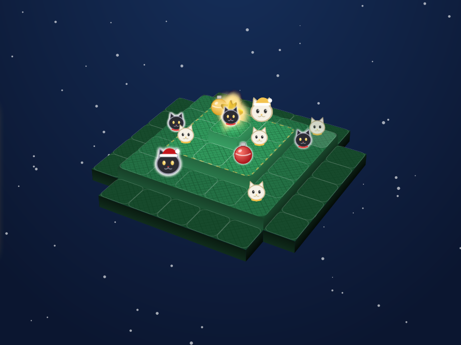
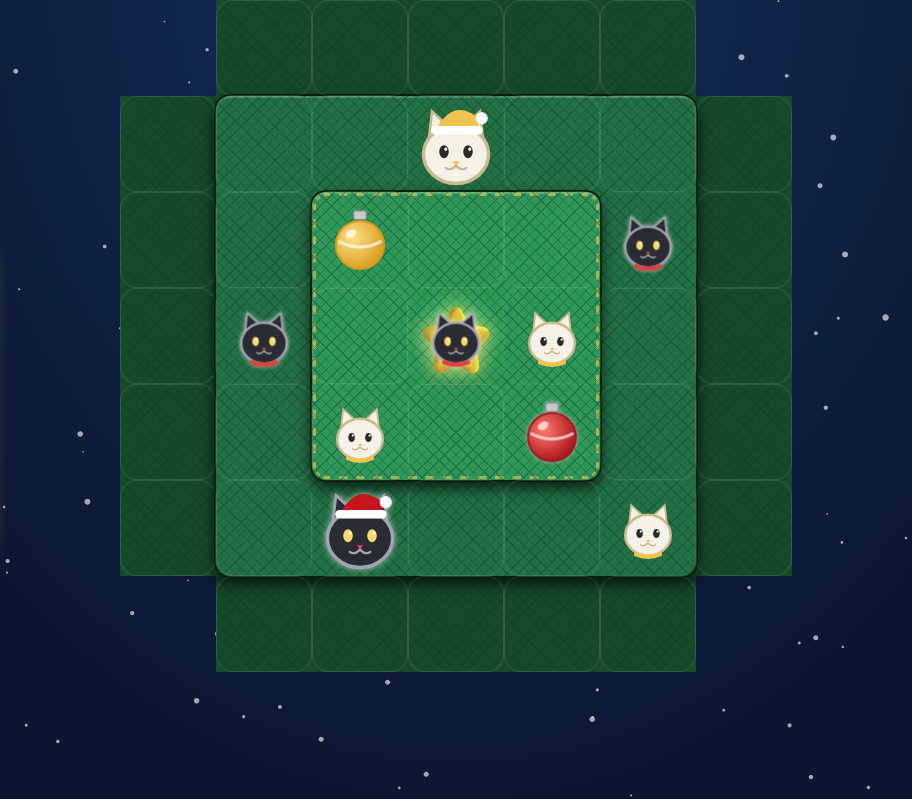
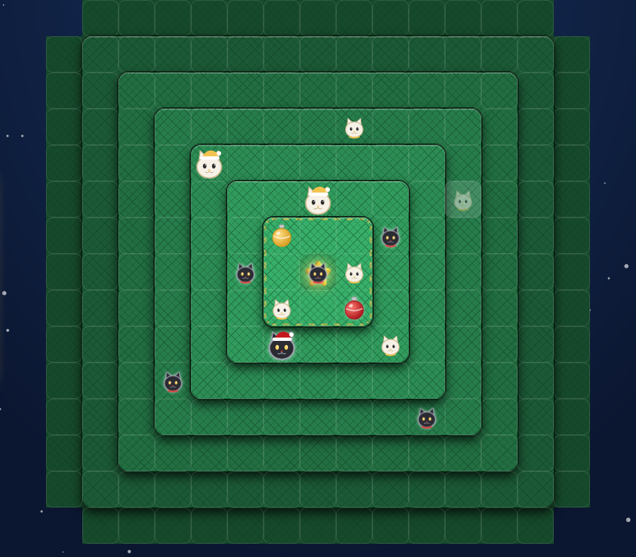
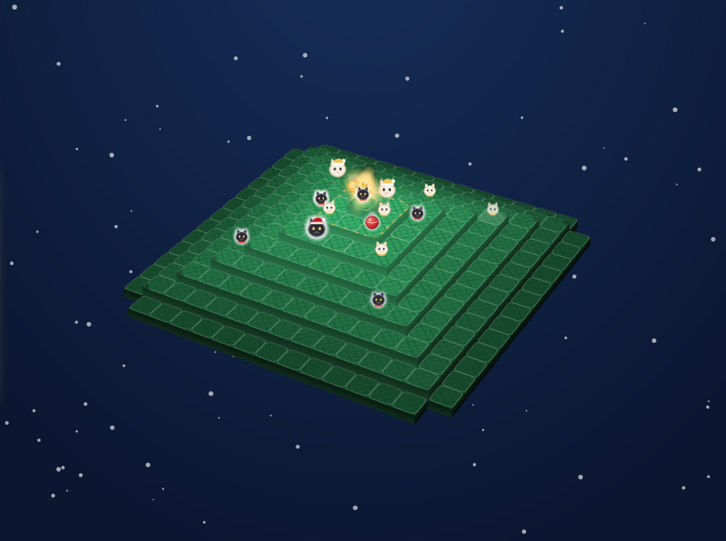

# 🎄 Boop Augmented

**Cats, a Christmas tree, and ornaments to knock off.** A free browser take on *boop the Halls!*, the Christmas edition of the board game **boop**, with two extras: a **Big tree** with up to 8 tiers and a **3D view**.

[▶️ How to run](#%EF%B8%8F-run-it) · [📜 Rules](#-how-to-play) · [🛠 Development](DEVELOPMENT.md)



## ✨ What's inside

- 🌲 **Classic tree**: 4 tiers on a 7×7 board (1, 8, 16 and 20 cells, base corners cut off), 8 kittens and 3 ornaments per player.
- 🌲🌲 **Big tree**: the same rules on 5 to 8 tiers, up to 15×15 and 221 cells. Kittens on **Auto** scale with the tree: 8 on the classic tree, +2 per extra tier (10, 12, 14, 16). You can also pick a fixed count from 8 to 16.
- 🎁 **More ornaments on big trees** (Auto): up to 6 per player, up to 3 hanging at once, hung on the 3rd tier from the bottom so they stay within reach. Capturing 3 still wins. The classic tree keeps the official rule.
- 🧊 **2D or 3D**: play from above, or switch to a 3D view of the stacked tree. Drag to orbit (sideways turns, up/down tilts), scroll to zoom, or use the ⟲ ⟳ ⤒ ⤓ − + ⌂ buttons. The star on top is a real 3D topper that turns with the tree.
- 🤖 **Play the computer** (you are white-and-gold **Snowball**, the computer is black-and-red **Coal**) or two players on one device.
- 🌐 **Play online with a friend**: press **Play online**, create a room and send the full invitation link. Keep the host tab open to admit the first join request as Coal; anyone after that can watch. Invitations identify the host and exact room creation. Old short room codes are no longer supported: create a new room instead. Moves travel as signed [Nostr](https://nostr.com) events through public relays, so there is no game server and no account.
- 💾 Local games save in your browser, with undo. Online games rebuild themselves from the room's events after a reload. No account, no tracking.

| Classic, from above | Big tree (8 tiers), from above | Big tree in 3D |
|---|---|---|
|  |  |  |

## 🎮 How to play

The board is a tree seen from above: the centre is the top, each ring outward is one tier lower. The ⭐ marks the **treetop**, the single cell of tier 1. Kittens and cats can stand there; ornaments can never get up there.

1. **Golden rule:** if you have no ornament on the tree, start your turn by hanging one on tier 2 (gold dashed ring). Ornaments do not boop.
2. Place a kitten (or a cat) on any free cell.
3. **Boop!** The new piece pushes every neighbour one cell away, if the cell behind it is free. A kitten or cat pushed off the tree goes back to its owner.
4. Kittens cannot boop cats. Cats boop everything.
5. Ornaments move sideways or down the tree, never up. Knock your opponent's ornament off and you capture it; knock your own off and it comes back to you.
6. **Pounce:** a cat pushed onto an ornament takes it (captured if it is the opponent's, returned if it is its own) and goes back to its owner's pool. A kitten pushed onto an ornament stays put.
7. Three of your pieces in a row leave the tree and the kittens become cats. If several lines form, you pick one.
8. All your pieces on the tree? Take one back; it returns as a cat.

**Win nice:** three cats in a row, or all your pieces on the tree as cats. **Win naughty:** capture 3 of your opponent's ornaments.

Keys: `K` kitten, `C` cat, `U` undo; in 3D `Q`/`E` rotate, `W`/`S` tilt, `+`/`-` zoom.

## ▶️ Run it

It is a static page with no build step:

```bash
python -m http.server 8000 --directory docs
```

Then open <http://127.0.0.1:8000/>.

## 🙏 Credits

*boop*, *boop the Halls!* and their rules are by Scott Brady, published by [Smirk & Dagger Games](https://smirkanddagger.com/products/boop-the-halls). This is an unofficial fan project, not affiliated with or endorsed by them. If you enjoy it, buy the real game: the 3D cardboard tree and the cat meeples are lovely. Rules were implemented from the publisher's [official rules on Dized](https://rules.dized.com/game/3hRB-k7FTiGQmV1HZ-W7Hw).

Code: MIT, see [LICENSE](LICENSE).
