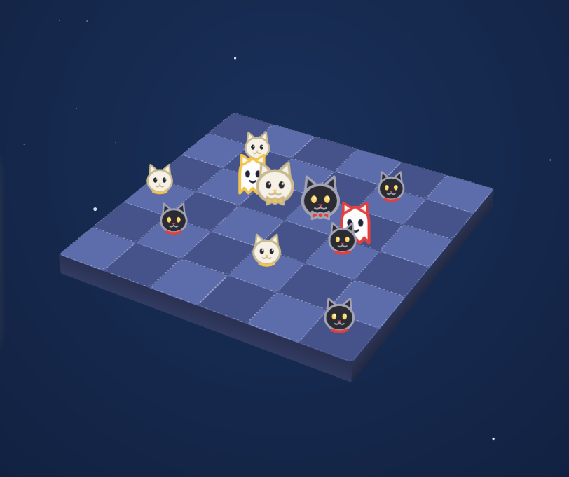
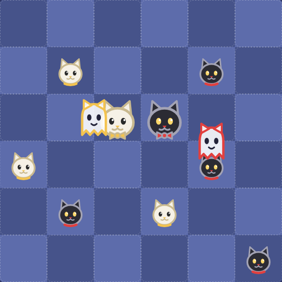
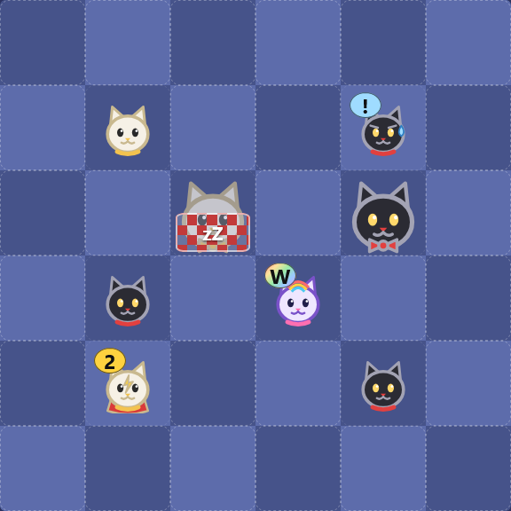
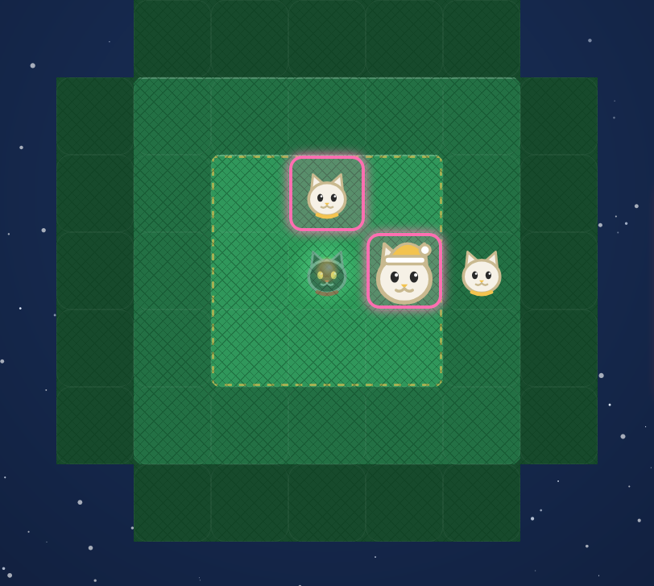

# 🐱 Boop Augmented

**Cats, a bed, and a lot of booping.** A free browser take on the board game **boop**: the classic square bed, the Christmas tree of *boop the Halls!*, bigger boards, 2 to 4 players, ghost cats, Boopmas spirits, a Shuffle-style board with power pieces, and a 3D view. No install, no account.

[▶️ Run it](#%EF%B8%8F-run-it) · [🎮 How to play](#-how-to-play) · [🧩 Variants](#-variants) · [🌐 Online](#-play-online) · [🛠 Development](DEVELOPMENT.md)



## ✨ What's inside

- 🟦 **Square board**: the plain 6×6 bed with 8 kittens each, no ornaments, no snow.
- 🌲 **Christmas tree**: the *boop the Halls!* board with ornaments, Santa hats and a "naughty" win. Big trees go up to 8 tiers.
- 👥 **2, 3 or 4 players** on every board: one device, against the computer, or online. Each seat has its own colour.
- 🧩 **Optional variants**: ghost cats, Boopmas spirits, Shuffle power pieces (details below).
- 🧊 **2D or 3D**: drag to orbit, scroll to zoom.
- 🎬 **Readable boops**: pieces glide for about a second, and a scared piece hops. With *prefers-reduced-motion* everything resolves instantly.
- 🐱 **Sharp cats**: flat vector art, thick outlines, no blur.
- 🌐 **Online rooms** over [Nostr](https://nostr.com) relays: no game server.
- 💾 Local games save in your browser, with undo. No tracking.

| Square with ghosts | Christmas tree | Big tree in 3D |
|---|---|---|
|  |  |  |

## ▶️ Run it

A static page with no build step:

```bash
python -m http.server 8000 --directory docs
```

Then open <http://127.0.0.1:8000/>.

## 🎮 How to play

Take turns placing a kitten (or a cat) on any free cell.

1. **Boop!** The new piece pushes every neighbour (8 directions) one cell away, if the cell behind it is free. A piece pushed off the board goes back to its owner. Pushed pieces do not push others.
2. Kittens cannot boop cats. Cats boop everything.
3. Three of your pieces in a row leave the board and the kittens become cats. If several lines form, you pick one.
4. All your pieces on the board? Take one back; it returns as a cat.

**Win:** three of your cats in a row, or all your pieces on the board as cats.

**On the Christmas tree** you also hang ornaments. With none of yours on the tree, start your turn by hanging one on the gold dashed ring. A cat pushed onto an ornament **pounces** and captures it. Capture 3 ornaments of other players to win **naughty**.

Keys: `K` kitten, `C` cat, `U` undo. In 3D: `Q`/`E` rotate, `W`/`S` tilt, `+`/`-` zoom.

## 🧩 Variants

Everything beyond the printed 2-player boop and boop the Halls! is a **house rule**. The printed rulebooks for the variants were not available to this project, so they are adapted from the publisher's pages, reviews and video walkthroughs. A physical copy may differ in details. The full, exact rules as implemented are in [DEVELOPMENT.md](DEVELOPMENT.md).

| Variant | Where | Inspired by | In one line |
|---|---|---|---|
| 📐 Bigger squares | Square, 7×7 to 10×10 | none (house rule) | Same rules; kittens on **Auto** grow by 2 per extra row. |
| 👥 3 and 4 players | every board | none (house rule) | Turns rotate; each seat has its own colour and pieces. |
| 👻 Ghost cats | Square | *BOOoop.* | Each player owns a ghost that walks across the bed and scares pieces. |
| 🎅 Boopmas spirits | Tree | *Ghosts of Boopmas!* | After a graduation the next seat may call a one-use spirit. |
| 🔀 Shuffle board | Square | *boop. Shuffle* | Wild, super and scaredy pieces, plus a blankie. No cards. |



### 👻 Ghost cats

Choose **Board: Square**, then **Ghost cats: On**.

- At the end of your turn you may send your ghost onto an **edge stitch** (the seam between two cells, shown as arrow buttons). **Keep it this turn** leaves it in your pool.
- At the end of each later turn of yours it moves one stitch forward and **scares** the two cells beside it, whatever their colour: the piece moves one cell away, **leaping over blockers**, or off the board.
- Ghosts block nothing and cannot be booped. Lines can form through them. Past the last stitch the ghost returns to your pool.
- Lines and wins are checked **after** the ghost moves. A line a ghost makes for someone else graduates at the end of their own turn, if it still stands.

### 🎅 Boopmas spirits

Choose the Christmas tree, then **Spirits: Boopmas spirits**.

- Whenever a player graduates a kitten, the **next seat** takes the spirit board with all three spirits fresh.
- The holder may call **one spirit per turn** together with a normal placement; each works once per hand-over:
  - **Psst Psst**: boops only diagonal neighbours.
  - **Yet to Pounce**: boops only straight neighbours.
  - **Jacob Meowly**: boops **one neighbour you choose**. A kitten may boop a cat, and a blocked piece **jumps over every piece in its way**.



### 🔀 Shuffle board

Choose **Board: Shuffle board** (6×6 to 10×10). The real *boop. Shuffle* is a card game; here there is **no deck and nothing hidden**. You pick the piece to place from your panel.

- **Wild**: 2 shared kittens that count as *your* piece on your turn and as your opponent's on theirs. They graduate into shared wild cats.
- **Super**: boops two cells. A super cat bumps a blocked neighbour over the whole line.
- **Scaredy**: gets pushed along whenever a piece lands beside it, and the reaction chains.
- **Blankie**: put a piece to sleep. It counts for no line and no win. Booping a sleeper takes the blanket off and moves it on.

## 🌐 Play online

Press **Play online**, create a room and send the full invitation link. Moves are signed Nostr events, so there is no game server and no account. The host seats each friend; a 3 or 4 player room starts once every seat is taken, and anyone else can watch.

Plain 2-player tree rooms keep the original `b2` format. Squares, ghosts, spirits, Shuffle and 3 to 4 players use a newer `b3` invitation that older copies of the page cannot join. Old short room codes no longer work.

## 🙏 Credits

*boop*, *boop the Halls!*, *the Ghosts of Boopmas!*, *BOOoop.*, *boop. Shuffle* and their rules are by Scott Brady, published by [Smirk & Dagger Games](https://smirkanddagger.com/). This is an unofficial fan project, not affiliated with or endorsed by them. If you enjoy it, buy the real games: the cat meeples are lovely.

Tree rules follow the publisher's [official rules on Dized](https://rules.dized.com/game/3hRB-k7FTiGQmV1HZ-W7Hw). Ghost cats follow the [BOOoop. rules on Dized](https://rules.dized.com/game/g-24GS5DSmGa8MoKVcP6XA/wEk-RecCSKeICE-l8osEvw/ghost-cats) as far as that page could be read.

Code: MIT, see [LICENSE](LICENSE).
